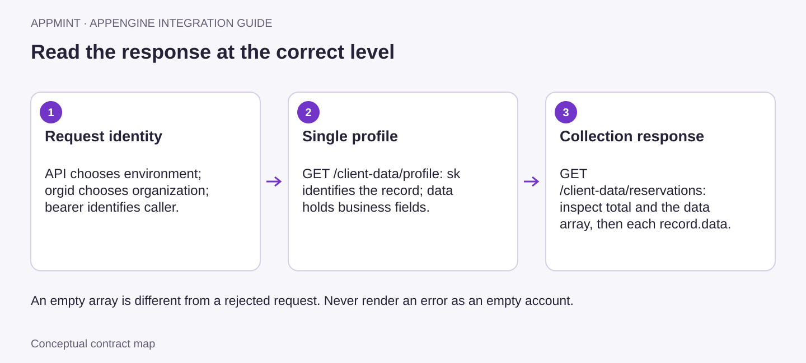

# AppEngine: Create Your Organization and Make Your First Authenticated Call

**Course ID:** `appengine-api-foundations`

**Video ready for review — 8:59, 16 chapters.** Watch the API Foundations course (additional repository resource: `/videos/appengine-api-foundations/course/review.html`; not included in this client download). Includes verified customer signup, sign-in, profile update/readback and refresh. Conditional challenge flows are illustrated; complete application-credential setup continues in Authentication.

## Why start here

You are building something customers use — a booking site, a member portal, a mobile app. The first thing it needs is accounts: people sign up, sign in, sometimes enter a code from their email, and then see and edit their own details. AppEngine provides those account actions. Customer signup checks for an existing account, hashes the supplied password and requests the configured welcome email. Sign-in applies the customer's verification and device settings, then issues the session your app sends with protected requests. You call it; you don't build an auth server.

In this course you create an organization for a small business — we'll call it **Juniper Yoga** — then sign up a customer, **Mira Chen**, sign her in, and read and edit her profile. That last call is the first protected request almost every customer app makes, and everything later in the AppEngine courses builds on it.

## 1. What AppEngine already has for accounts

Three words first, because every request uses them.

- **Organization** — one business on AppEngine. Every organization has an ID (for example `juniper-yoga`), and every request names it in an `orgid` header so AppEngine knows whose data you mean.
- **Data type** (also called a *collection*) — a kind of record, such as `customer` or `reservation`. AppEngine ships about 270 of them with their fields already defined.
- **Record** — one saved item. Every record comes back in the same envelope: `sk` is its ID, `datatype` is its type, `pk` is `<organization>|<datatype>` (which organization it belongs to), and `data` holds the business fields.

### Built-in data types for accounts

| Data type | Who it is | A few of its real fields (`data.…`) |
|---|---|---|
| `customer` | A person the business serves — Mira | `email`, `firstName`, `lastName`, `phone`, `groups`, `status`, `address` |
| `user` | A staff member — you, the owner | `email`, `username`, `firstName`, `lastName`, `roles`, `groups`, `status` |
| `apikey` | A credential for a server-to-server integration | `name`, `scopes`, `keyPrefix`, `status`, `rateLimit` |

Customers and staff are different record types. The same email can exist as both, and each signs in through its own route.

### Built-in actions for accounts

| You call | AppEngine does for you |
|---|---|
| `POST profile/customer/signup` | refuses an email that already has an account, hashes the supplied password, saves the `customer` record, requests the `customer-welcome` notification, records the device and the sign-up activity, returns a session |
| `POST profile/customer/signin` | checks the password, refuses blocked devices, asks for a second code when two-factor is on or the device is new, records the login, returns the customer and a session |
| `POST profile/security/challenge/verify` | checks the emailed, texted or authenticator code and finishes the sign-in |
| `POST profile/customer/refresh` | checks the refresh token and that the account still exists, and issues a fresh access token |
| `GET client-data/profile` | with a customer session, returns the customer record matching that identity |
| `PUT client-data/profile` | lets the customer change their own `firstName`, `lastName` and `phone`, and nothing else; marks a changed phone as unverified |
| `POST profile/user/signin` | applies staff password, verification and device policies, then returns the staff record and resolved roles |

**The rule.** Use the built-in action whenever one exists. If you created Mira by writing a `customer` record directly through the generic record routes, you would skip everything in the right-hand column: no duplicate check, no password hashing, no welcome email, no session. Use the built-in `customer` type for the person, and add your own fields to it if you need more. Only make a collection of your own for something AppEngine doesn't have at all — the Data Records course (additional repository resource: `../appengine-data-records/script.md`; not included in this client download) covers that.

<a id="prepare-the-environment"></a><a id="create-the-organization-and-application-credentials"></a><a id="obtain-the-organization-and-staff-access"></a>
## 2. Create the organization

Open `https://appmint.io/signup` (or **Start free** on the Appmint home page).

1. Choose **Continue with Email** and use an inbox you can read.
2. On **Finish your account**, type a **site-name** (the screen adds `.appmint.app` for you), the owner's first and last name, and a password twice.
3. Select **Create account**.

The welcome screen shows three things to keep: the **Organization ID**, the **Sign in at** address and your owner email. **Open Studio Manager** takes you to the admin app, at `https://studio.appmint.io` on the hosted service. You don't need to build a website to use the API.

The hosted AppEngine API lives at `https://appengine.appmint.io`. This is the address your code calls — not the Studio address and not your `.appmint.app` site. If your company runs its own Appmint installation, ask its administrator for the external AppEngine address and an organization on that installation; an account made on the hosted service doesn't exist on a private one.

Put both values in your shell and check the server answers:

```bash
API='https://appengine.appmint.io'
ORG='juniper-yoga'          # your Organization ID
curl -sS "$API/health"
```

A healthy server returns HTTP 200 with `"isHealthy": true`. `/health` needs no organization or sign-in, so it only tells you the address is right.

## 3. Sign up a customer

Mira signs up from your app. Your app sends one request:

```bash
curl -sS -X POST "$API/profile/customer/signup" \
  -H "orgid: $ORG" -H 'Content-Type: application/json' \
  --data '{"email":"mira@example.com","password":"a-strong-password","firstName":"Mira","lastName":"Chen"}'
```

AppEngine answers with the new record and a session straight away:

```json
{
  "customer": {
    "pk": "juniper-yoga|customer",
    "sk": "66f1c2a9e4b0a1d2c3e4f501",
    "datatype": "customer",
    "data": {
      "email": "mira@example.com",
      "username": "mira@example.com",
      "firstName": "Mira",
      "lastName": "Chen",
      "groups": ["Customer"]
    }
  },
  "token": "eyJhbGciOi…",
  "refreshToken": "eyJhbGciOi…"
}
```

The response omits the password. AppEngine requests the configured `customer-welcome` notification separately; the session response does not confirm email delivery. If your app should supply a storefront link in that message, send its public address in `x-client-host`. Check the configured email delivery and the recipient's inbox to confirm receipt. Signing up the same email twice returns `400` with *"An account with this email already exists. Please login instead."* — show that message and offer sign-in.

Two terms you'll see from here on:

- **Access token** (`token`) — proves who is calling. Your app sends it as `Authorization: Bearer <token>` (a *bearer token*: whoever holds it is treated as that person, so keep it private).
- **Refresh token** (`refreshToken`) — used only to get a new access token when the old one expires (section 6).

<a id="2-obtain-a-person-session"></a><a id="finish-a-temporary-password-sign-in"></a>
## 4. Sign her in

Next time, Mira signs in:

```bash
curl -sS -X POST "$API/profile/customer/signin" \
  -H "orgid: $ORG" -H 'Content-Type: application/json' \
  --data '{"email":"mira@example.com","password":"a-strong-password"}'
```

The usual answer is the same shape as sign-up — `customer`, `token`, `refreshToken` — plus `orgId`. A wrong password returns `400` with `bad password`.

Your app should read the answer before it treats Mira as signed in, because there are two other answers. Check `requiresPasswordChange` and `requiresTwoFactor` before accepting `token` as a completed session: the temporary-password response can contain tokens too.

**A second code is needed.** If the business has turned on two-factor sign-in, or Mira is on a new device and the business asks for confirmation, the answer has no token yet:

```json
{
  "requiresTwoFactor": true,
  "challengeToken": "eyJhbGciOi…",
  "twoFactorMethod": "email",
  "message": "Verification code sent to your email"
}
```

For an email or SMS challenge, AppEngine has requested the code's delivery. Ask Mira for the received code and send it back with the challenge token:

```bash
curl -sS -X POST "$API/profile/security/challenge/verify" \
  -H "orgid: $ORG" -H 'Content-Type: application/json' \
  --data '{"challengeToken":"eyJhbGciOi…","code":"482913","trustDevice":false}'
```

The answer carries `token`, `refreshToken` and the person's record under `user` (the same field name is used for customers and staff here). Set `trustDevice` to `true` if Mira ticks "remember this device". To send a fresh code, call `POST profile/security/challenge/send` with the same `challengeToken`. Authenticator-app codes are made on Mira's phone, so there is nothing to resend.

**A new password is needed.** If Mira signs in with a temporary password, the answer has `requiresPasswordChange: true`, her `userId`, a `message`, and tokens. Keep her on a "choose a new password" screen. Use the returned access token for the protected password-change request, with the same organization:

```bash
# TEMP_TOKEN is the token from that temporary-password response.
# Copy its userId into the JSON body below.
# Enter passwords privately; do not put real values in a shared script or recording.
curl -sS -X POST "$API/profile/customer/password/change" \
  -H "orgid: $ORG" -H "Authorization: Bearer $TEMP_TOKEN" \
  -H 'Content-Type: application/json' \
  --data '{"userId":"<returned userId>","password":"<temporary password>","newPassword":"<chosen new password>"}'
```

After the change succeeds, discard the temporary-flow tokens and sign her in again with the new password. Complete any verification that this new sign-in requests before opening the app.

So your sign-in code has four outcomes: signed in, needs a code, needs a new password, refused. Establish the normal application session only when neither challenge flag is set and a token is present. Keep temporary-flow credentials private and scoped in your app to completing the password change.

## 5. Read and edit her profile

Now the protected call. Send the organization and Mira's access token:

```bash
TOKEN='eyJhbGciOi…'   # Mira's access token
curl -sS "$API/client-data/profile" \
  -H "orgid: $ORG" -H "Authorization: Bearer $TOKEN"
```

AppEngine works out who Mira is from the token and returns her own `customer` record — the same envelope as at sign-up, with `sk` as her ID and her details under `data`. Check `sk` and `data.email` match the person who signed in before you show the page.



*The organization and token pick whose data you get; `sk` identifies the record; business fields live under `data`. Lists wrap their records in a `data` array.*

Mira changes her first name and adds a phone number:

```bash
curl -sS -X PUT "$API/client-data/profile" \
  -H "orgid: $ORG" -H "Authorization: Bearer $TOKEN" \
  -H 'Content-Type: application/json' \
  --data '{"firstName":"Mira-Lin","phone":"+1 415 555 0134"}'
```

```json
{
  "sk": "66f1c2a9e4b0a1d2c3e4f501",
  "datatype": "customer",
  "data": { "firstName": "Mira-Lin", "lastName": "Chen", "phone": "+1 415 555 0134", "phoneVerified": false }
}
```

AppEngine saved the change, read it back, and returned the fields a customer may edit. Because the phone changed, it is marked unverified. Send any other field — `email`, `groups` — and you get `400` with *"Only firstName, lastName and phone can be updated"*. Email and group changes go through their own actions, so a customer can't promote themselves.

The same token reads Mira's other things: `GET client-data/reservations` and `GET client-data/orders`. Lists come back as a page — `total`, `page`, `pageSize`, `hasNext` and a `data` array of records — and an empty `data` array for a new customer is a correct answer, not an error. The Customer Portal course (additional repository resource: `../appengine-customer-portal/script.md`; not included in this client download) builds those screens.

## 6. Keep the session going, and read the errors

Access tokens expire. When an otherwise valid session expires, use its refresh token once and retry the protected call. For other `401` responses, check the error first: an organization mismatch needs the correct `orgid`, while `session_revoked` or `device_blocked` requires sign-in or account support rather than a refresh loop.

```bash
curl -sS -X POST "$API/profile/customer/refresh" \
  -H "orgid: $ORG" -H 'Content-Type: application/json' \
  --data '{"refresh_token":"eyJhbGciOi…"}'
```

The answer is `{ "user": {…}, "token": "<new access token>", "refreshToken": "<the same refresh token>" }`. Save the new `token` and retry the call that failed. If the refresh itself returns `401`, the session is over: send Mira back to sign-in. Staff use `POST profile/user/refresh` the same way; for staff it also refuses locked accounts, sessions ended by a password change, and blocked devices.

| You see | It means | Do this |
|---|---|---|
| `404` `Not Found` for the demonstrated request without `orgid`; some request paths report `400` `missing_orgid` | The organization header is absent; an earlier server guard can reject the request before the later organization check | Restore the correct `orgid` and retry the same request; inspect the body as well as the status |
| `400` `bad password` | Wrong email or password | Show "email or password is wrong" |
| Successful status with `requiresTwoFactor` | A code is needed | Ask for it and call `challenge/verify` |
| Successful status with `requiresPasswordChange` | A temporary password was used, even if tokens are present | Finish the protected password-change flow, then sign in again |
| `400` `invalid_code` | The verification code was refused | Check the code and retry verification |
| `400` `challenge_expired` | The verification session expired | Start sign-in again to obtain a new challenge |
| `401` | Expired, invalid, revoked or wrong-organization identity | Check the organization and error; refresh an expired session once, otherwise sign in again as directed |
| `403` | Signed in, but not allowed to do this | Check the account's permissions — retrying won't help |
| `503` | AppEngine couldn't reach its database | Keep the session and try again shortly |

## 7. Sign in as the owner

Everything so far was Mira. Some setup in the next section — and in later courses — is done by staff. You, the owner, are a `user` and sign in through the staff route:

```bash
curl -sS -X POST "$API/profile/user/signin" \
  -H "orgid: $ORG" -H 'Content-Type: application/json' \
  --data '{"email":"owner@example.com","password":"your-owner-password"}'
```

A completed staff sign-in has `user` (your staff record, with your `roles`), `orgId`, `token` and `refreshToken`. Staff sign-in can also require two-factor verification or a password change; handle its flags before opening the staff session. Keep the completed session's token as `STAFF_TOKEN`. Staff permissions come from roles and groups set up in Studio; the Roles and Permissions course (additional repository resource: `../am-roles-permissions/script.md`; not included in this client download) covers that.

<a id="3-understand-the-official-clients-two-credentials"></a><a id="create-the-credential-required-by-the-current-reference-clients"></a>
## 8. Connect your real app

Your curl calls sent Mira's token straight to AppEngine. A real app does one of three things, depending on what it is.

| You are building | What it sends | Set up |
|---|---|---|
| A mobile app or a website that calls AppEngine for one signed-in person | `orgid` + that person's `Authorization: Bearer` token | Nothing more — what you did above |
| A website with its own server in front (Next.js, Remix, any backend) | Your server sends an **app token** as `Authorization` and the person's token as `x-client-authorization` | An App Credential, below |
| A background job with no person, such as a nightly export | `orgid` + `x-api-key` | A scoped API key — see Authentication (additional repository resource: `../appengine-auth-org-isolation/script.md`; not included in this client download) |

The official Appmint JavaScript and Flutter clients use the second pattern. The app token says "this is Juniper Yoga's booking site"; the person token says "and Mira is using it". To get one, create an **App Credential** in Studio: **Configuration → User Management → More → App Credentials**, then **Create Credential**. Enter an **App ID** (3–50 letters, digits, `_` or `-`, for example `juniper-site`) and an **App Name**, and submit. Copy the **App Secret (Password)** from the confirmation — it is shown only once. Studio labels this screen *Legacy Authentication Method* and points new server-to-server integrations at API keys; it remains the credential the official clients expect.

Staff with the `ConfigAdmin` role can do the same through the API:

```bash
curl -sS -X POST "$API/profile/app/register" \
  -H "orgid: $ORG" -H "Authorization: Bearer $STAFF_TOKEN" \
  -H 'Content-Type: application/json' \
  --data '{"appId":"juniper-site","appName":"Juniper booking site","description":"Website server"}'
```

The answer is the new credential record with `data.username` (the App ID) and `data.secret` (the one-time secret). Your server exchanges them for an app token:

```bash
curl -sS -X POST "$API/profile/app/key" \
  -H "orgid: $ORG" -H 'Content-Type: application/json' \
  --data '{"appId":"juniper-site","secret":"the-one-time-secret"}'
```

```json
{ "appConfig": { "sk": "…", "datatype": "user", "data": { "username": "juniper-site", "userType": "app" } }, "token": "eyJhbGciOi…" }
```

Then the profile call from your server looks like this:

```http
GET /client-data/profile
orgid: juniper-yoga
Authorization: Bearer <app token>
x-client-authorization: Bearer <Mira's token>
```

Keep the secret and the app token on your server only. An App Credential belongs to the `System` group, so anyone who pulls it out of a web page or a phone app can act as your integration. The Authentication course (additional repository resource: `../appengine-auth-org-isolation/script.md`; not included in this client download) builds this server, with a runnable lab.

<a id="1-discover-before-choosing-a-route"></a>
**Demonstration boundary.** This course proves customer signup, ordinary sign-in, profile read/update/read-back, refresh and a corrected missing-organization request on a controlled training deployment. External email delivery was disabled for that demonstration; no welcome email or verification-code delivery is claimed. The verification and temporary-password sequences explain conditional contracts. The App Credentials recording shows the actual menu, list and blank creation form; credential creation, one-time-secret retrieval, app-token exchange and scoped-key permission checks are not demonstrated successes here. Use the linked Authentication course for that complete setup before adopting those integration patterns.

## 9. Where to go next

- Find any endpoint in the API reference (additional repository resource: `../appengine-api-reference/script.md`; not included in this client download) — the reference that ships with every AppEngine server, walked through by building a booking page.
- Authentication, API keys and organization isolation (additional repository resource: `../appengine-auth-org-isolation/script.md`; not included in this client download) — the browser-server pattern, scoped keys for jobs, and proving one customer can't read another's data.
- Customer Portal (additional repository resource: `../appengine-customer-portal/script.md`; not included in this client download) — Mira's bookings, orders and messages on top of this sign-in.
- Identity Provider (additional repository resource: `../appengine-identity-provider/script.md`; not included in this client download) — let staff sign into a different app with their Appmint account.
