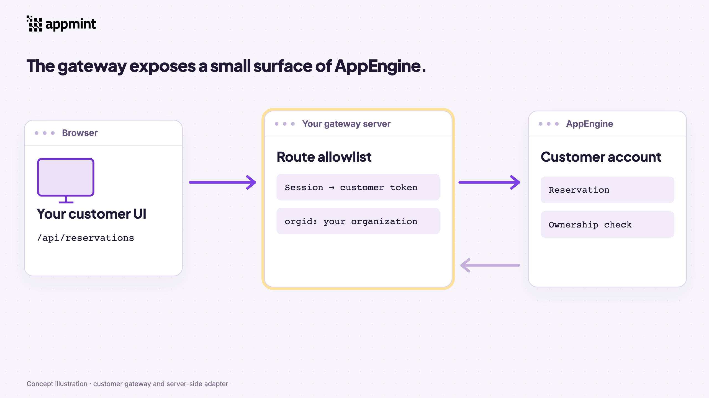
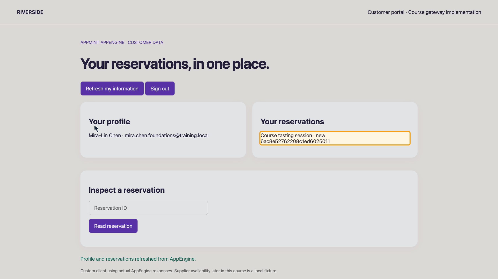
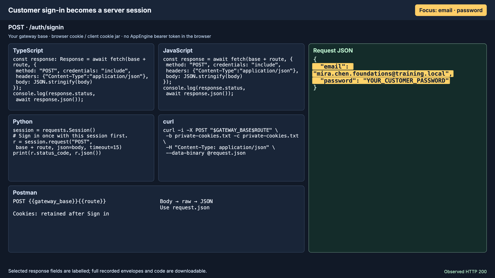
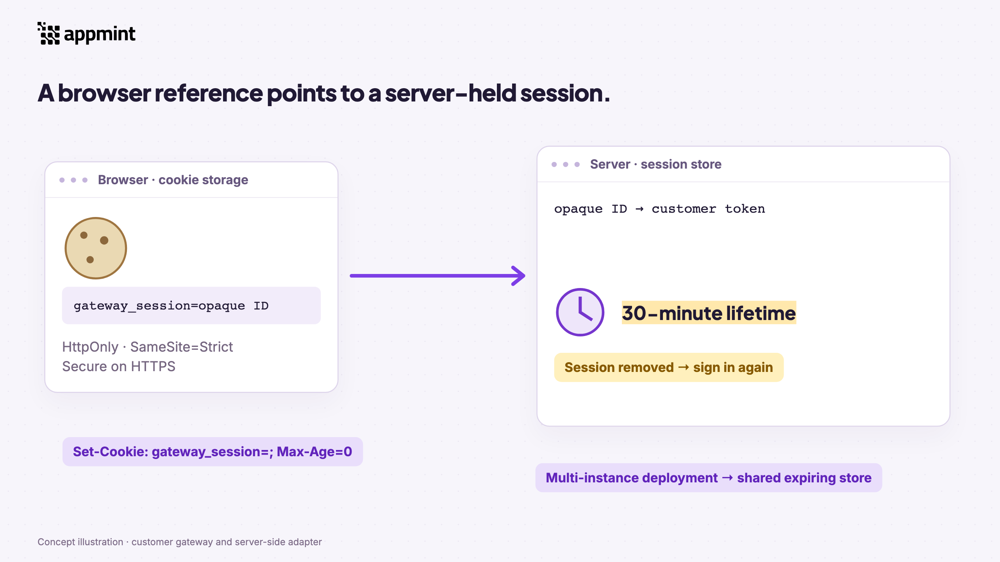
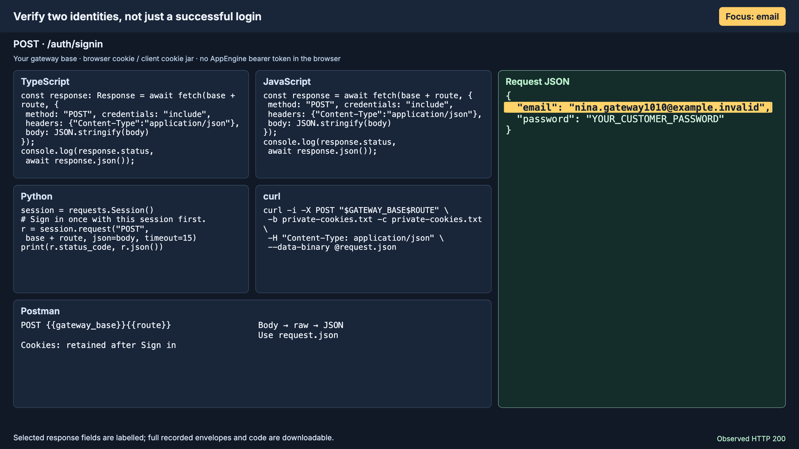
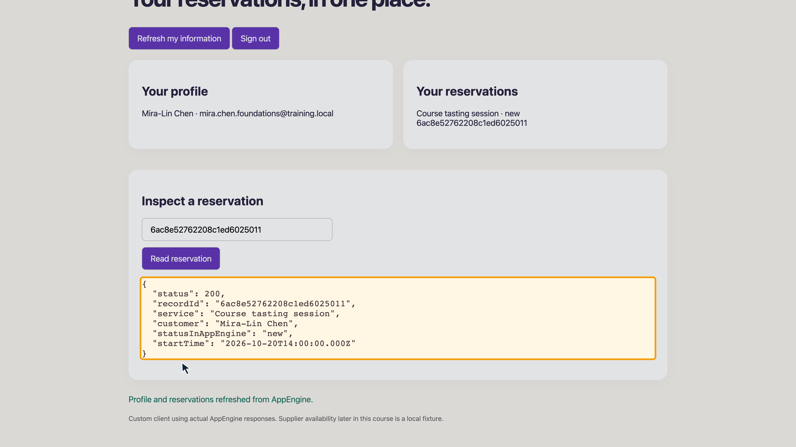
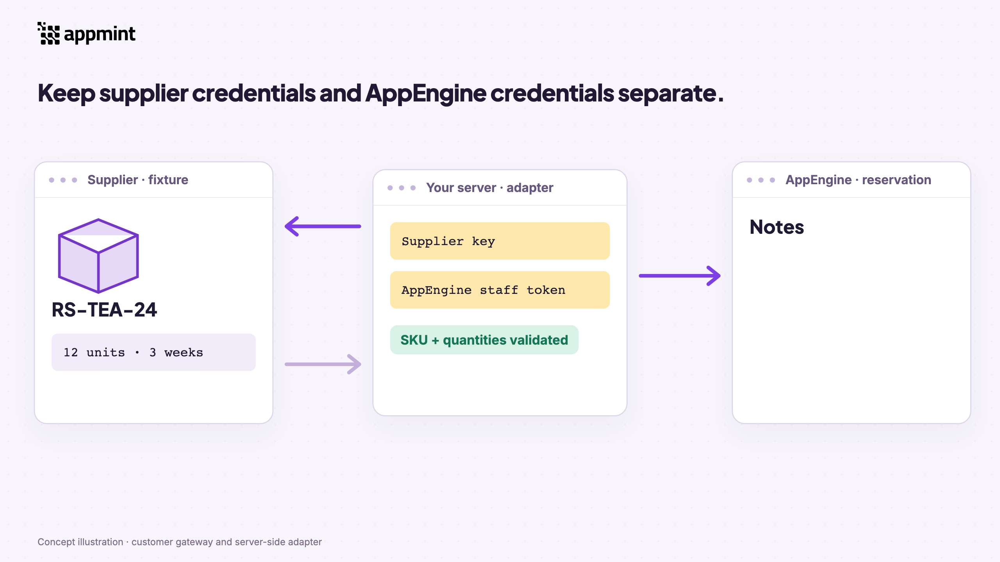

# AppEngine Custom API Gateway: Customer Sessions, Route Isolation and Server-Side Adapters

Build your own customer-facing server without duplicating AppEngine's identity and business-record services. This course delivers a working customer portal, an allowlisted gateway and a separate supplier adapter that saves a verified reservation note.

Course catalogue (additional repository resource: `/videos/course-catalogue/?product=AppEngine#appengine-custom-api-gateway`; not included in this client download) · Watch the review video (additional repository resource: `/videos/appengine-custom-api-gateway/course/review.html`; not included in this client download) · Download the complete examples (additional repository resource: `/videos/appengine-custom-api-gateway/course/gateway-examples.zip`; not included in this client download)

The recorded application uses real AppEngine customer and reservation responses from an isolated training deployment. The supplier is an explicit local fixture. Application-token plus customer-token mode is explained as an alternative, not claimed as executed. The downloadable server is a complete teaching implementation; production session storage, deployment and verification branches require the choices described below.

## 1. What the gateway does

A gateway is your server application between a client and AppEngine. It exposes a focused API for your UI, attaches the correct organization and identity, and lets AppEngine own the business record. It is useful when your browser should not hold a platform bearer token, when your interface needs a small stable contract, or when server-side work must combine AppEngine with another system.



Our client asks for `/api/profile` or `/api/reservations`. Those are routes implemented by the downloaded gateway. They map to AppEngine's `/client-data/profile` and `/client-data/reservations`. Distinguish the two base addresses: **GATEWAY_BASE** is your own server, while **APPENGINE_ENDPOINT** is your AppEngine API address. `orgid` is supplied by the gateway's server configuration, not copied from a browser header.

The working route uses the signed-in customer's token directly in `Authorization`. The server keeps it private and gives the browser an opaque session identifier. Do not infer that any arbitrary AppEngine route is safe for a customer simply because these profile and reservation routes work.

## 2. Obtain the platform prerequisites

Use an isolated organization and non-sensitive test accounts. You need:

- Your actual AppEngine API base and organization ID: AppEngine Introduction (additional repository resource: `/videos/appengine-introduction/course/review.html`; not included in this client download), with the written platform introduction (additional repository resource: `/videos/course-catalogue/materials/appengine-developer-course-script.html`; not included in this client download).
- A customer email and password in that organization: API Foundations (additional repository resource: `/videos/appengine-api-foundations/course/review.html`; not included in this client download) and its written customer identity procedure (additional repository resource: `/videos/course-catalogue/materials/appengine-api-foundations-script.html`; not included in this client download). Signup and signin are different operations; do not call signup repeatedly for an existing account.
- A staff token authorized to inspect the chosen reservation and write its note: Database & Repository APIs, chapter 2 at 1:02 (additional repository resource: `/videos/appengine-data-records/course/review.html#t=62`; not included in this client download). Use `POST /profile/user/signin` with `orgid` and your staff credentials. Resolve returned challenges before accepting a token. A customer token is not a substitute for the adapter's staff token.
- Node.js 20 or newer. The JavaScript gateway, supplier fixture and adapter use built-in modules and need no npm install. Python's packaged client uses the standard library; the equivalent concise Python video snippets use `requests`, if you prefer that library.

Keep credentials in a private environment or a deployment secret store. The download contains placeholders and sanitized evidence, never working passwords or tokens. Hosted production addresses are not inferred from the local training environment.

## 3. Prepare two customers and a reservation

Customer A needs one reservation, and customer B must be a different account. The filmed example reuses Mira-Lin's tasting reservation, ID `6ac8e52762208c1ed6025011`; this is evidence from the course organization, **not an ID to use in your organization**. Nina is the second ordinary customer and has no reservations.

To reproduce the fixture with your own records, complete CRM APIs: reservation definitions, slots and booking (additional repository resource: `/tutorials-plan/course-content/courses/appengine-crm-apis/index.html`; not included in this client download). Create or select an active reservation definition, select its service and available slot, and save the booking using customer A's identity/contact details. Record the returned reservation `sk`, not its display confirmation number. Read it through customer A's `/client-data/reservations/:id` and confirm its `data.customerId` identifies that customer. Keep the booking in a state suitable for your test. Do not use a random staff-created booking without checking that ownership matches.

For a direct API preparation, first read `GET /crm/reservations/definitions`, then use the definition/slot procedures in the linked CRM course. The create route accepts the following shape; substitute a real available slot and service from your own definition:

```json
{
  "reservationDefinitionId": "YOUR_DEFINITION_SK",
  "service": "YOUR_SERVICE_NAME",
  "startTime": "YOUR_AVAILABLE_SLOT_START",
  "endTime": "YOUR_AVAILABLE_SLOT_END",
  "customer": {
    "name": "YOUR_CUSTOMER_NAME",
    "email": "YOUR_CUSTOMER_EMAIL"
  }
}
```

Send it to `POST /crm/reservations/create` with the organization and appropriate signed-in identity. Booking creation can trigger configured confirmation/reminder messages. Use a deliberate training notification policy and addresses you control; do not treat this example as a silent fixture generator. The filmed reservation was reused, so this course does not claim a new booking creation demonstration. The training organization's existing inactive mail boundary prevented external delivery when the second customer was prepared.

## 4. Run the complete gateway

Unzip the examples, open that directory, and set the two required values:

```sh
export APPENGINE_ENDPOINT='https://YOUR_APPENGINE_HOST'
export ORG_ID='YOUR_ORGANIZATION_ID'
node gateway.mjs
```

The teaching server listens only on your machine at port 4320. Open `http://127.0.0.1:4320/` in your browser. This loopback address is for running the download locally, not a claim about Appmint's hosted signup or API address. For another port, set `PORT`; set `PUBLIC_ORIGIN` to the exact browser origin when deploying behind a reverse proxy. Use HTTPS in deployment so the cookie receives `Secure`.

The startup message confirms a listening process; the real check is signing in and seeing your own AppEngine profile and reservation. There is no second application database to seed. The supplied `portal.html` reads the gateway's actual JSON responses.



## 5. Sign in and create an opaque session

The browser sends `POST /auth/signin` to the gateway with `{ "email": "YOUR_CUSTOMER_EMAIL", "password": "YOUR_CUSTOMER_PASSWORD" }`. The gateway sends those credentials to AppEngine's `POST /profile/customer/signin`, including its configured `orgid`.

The current AppEngine challenge flag is **requiresTwoFactor**, not only `requires2FA`. The example accepts both names for compatibility and also handles `requiresPasswordChange`. These branches return 409 with an explicit message: complete the corresponding API Foundations verification/password procedure (additional repository resource: `/videos/course-catalogue/materials/appengine-api-foundations-script.html`; not included in this client download) before continuing. This starter does not implement every verification screen. Do not discard a challenge and treat a partial response as a usable bearer token.

On ordinary success, the gateway stores the customer token in memory, keyed by a random opaque ID. Its HTTP response body is `{ "signedIn": true }`. The separate **Set-Cookie header** contains `gateway_session=<opaque ID>`; it is not a JSON field. The token is never returned to browser JavaScript.



## 6. Understand cookie and session lifetime

`HttpOnly` prevents client JavaScript from reading the cookie. `SameSite=Strict` restricts cross-site sending. `Path=/` makes it available to this application's routes. `Max-Age=1800` matches the starter's thirty-minute server session. `Secure` is added when `PUBLIC_ORIGIN` uses HTTPS. These settings complement origin checks and a narrow route table; they do not replace authorization.



The memory map is appropriate for this runnable teaching example. Restarting the process invalidates every session; two separate processes do not share it. Use an expiring shared store for multiple production instances. Keep provider credentials, bearer tokens and cookie values out of logs. Log non-secret correlation IDs and response statuses instead.

The example rejects a supplied nonmatching Origin for state-changing requests. A same-origin browser sign-in and sign-out work normally. Non-browser clients may omit Origin and use their own cookie jar. Add deployment-appropriate rate limiting and abuse controls before exposing sign-in publicly.

## 7. Expose only intended routes

The implementation allows these GET routes:

| Gateway route | AppEngine route |
|---|---|
| `/api/profile` | `/client-data/profile` |
| `/api/reservations` | `/client-data/reservations` |
| `/api/reservations/:id` | `/client-data/reservations/:id` |

The single-record route accepts a 24-character hexadecimal record ID. The method is part of the allowlist: POST to `/api/reservations` is not silently forwarded. Unmatched paths, including repository routes, return 404. The gateway never forwards browser-supplied `Authorization`, `orgid` or `x-client-authorization` headers.

Before adding a route, inspect its actual AppEngine controller/service contract, expected identity and ownership checks. Staff notes are deliberately not exposed through the customer gateway. AppEngine's notes endpoint is not used as a demonstration of customer-isolated note access.

## 8. Verify both identities and refusal paths

Sign in as customer A using the browser, the packaged client, or Postman. Read profile, list reservations, then read the returned reservation ID. Confirm the profile identity and reservation `data.customerId` agree. Repeat with a **separate cookie jar** for customer B.

| Actual filmed check | Result |
|---|---|
| Mira profile and own reservation | 200; matching customer and booking |
| Nina profile | 200; Nina's own account |
| Nina reservation list | 200; empty array |
| Nina requests Mira's reservation ID | 404; no booking returned |
| Missing gateway session | 401 before forwarding |
| Repository path / disallowed method | 404 |
| Sign out, then reuse old cookie | 401 |



A 404 is deliberately preserved for an inaccessible reservation. Do not convert it into a fabricated empty object with a success status. Likewise, an empty list is a valid successful query; do not confuse it with an unavailable API.

The download's Python, JavaScript and curl clients retain cookies between commands. Use `COOKIE_JAR` to choose separate private files for the two accounts. Sign in first; do not manually paste a platform token into a gateway cookie.

```sh
python3 client.py signin
python3 client.py profile
python3 client.py reservations
python3 client.py reservation YOUR_RESERVATION_SK
python3 client.py logout
```

Python prompts privately for the password when it is not provided in the environment. The JS/curl clients read `CUSTOMER_EMAIL` and `CUSTOMER_PASSWORD` from your private environment. Postman retains Set-Cookie in its cookie jar. The request examples include exact method, route, body and observed response separately.

## 9. Use the actual browser result

Open the supplied portal, sign in as customer A and use **Refresh my information**. The profile and list are rendered from the fresh gateway responses. Enter the reservation `sk`, choose **Read reservation**, and inspect the selected real fields: HTTP status, record ID, service, customer, business status and start time.



**Sign out** calls the server, removes its session entry and clears the browser cookie. The client returns to sign-in. This is a custom client implementation for the course, not Appmint Studio or an invented hosted product interface.

## 10. Discover built-in integrations before writing an adapter

Use `GET /upstream/integration-use-cases/Shipping` to inspect supported shipping providers and their configuration schemas. In the filmed deployment, EasyPost and Shippo appear with operations such as rates, shipment creation and tracking. Discovery is not evidence that a provider is configured or that a shipment succeeded.

`GET /upstream/integration-use-cases/Inventory` returned `[]`. That describes this deployment's returned provider catalogue at recording time; it is not a permanent platform limitation. If an appropriate built-in provider exists, use its supported configuration and operation workflow. A custom adapter is useful for supplier-specific work that does not already have a suitable provider.

## 11. Keep the supplier adapter separate

The supplier fixture models one availability endpoint. It is explicitly **Riverside Provisions — local fixture**. `GET /availability?sku=RS-TEA-24` with the training supplier key returns 12 units and a three-week lead time. This is not a commercial provider connection, purchase order or stock reservation.



The adapter uses a supplier key only for the supplier request. It uses a staff token only for the AppEngine note write. Neither belongs in browser code. It validates that the returned SKU matches and that stock/lead time are finite nonnegative numbers. Only then does it construct a timestamped comment for the exact reservation ID.

## 12. Run the adapter and read the saved note

In a separate terminal, start the harmless fixture:

```sh
node supplier-fixture.mjs
```

Then configure the adapter in a private terminal environment:

```sh
export APPENGINE_ENDPOINT='https://YOUR_APPENGINE_HOST'
export ORG_ID='YOUR_ORGANIZATION_ID'
export STAFF_TOKEN='YOUR_PRIVATE_STAFF_TOKEN'
export SUPPLIER_URL='http://127.0.0.1:4311'
export SUPPLIER_KEY='tutorial-fixture-only'
export RESERVATION_ID='YOUR_CUSTOMER_A_RESERVATION_SK'
node check-supplier.mjs RS-TEA-24
```

The supplier address and key above are deliberately for the included local fixture. Replace them with a real provider's documented endpoint and private credential when implementing that integration.

The adapter posts `{ "comment": "..." }` to `/notes/reservation/:id`, then performs a separate GET to the same route. It searches for the exact generated comment. An output containing `noteVerified: true` means that readback succeeded. The filmed note explicitly says **Supplier fixture, not a placed order**. Inspect the actual booking ID before running: the notes service's write response alone does not prove the intended parent record was found.

The example adds a note; it does not replace or delete existing notes. If you made a mistaken business comment, add an explicit correction using the application's supported note workflow instead of claiming that the adapter's retry logic can undo it.

## 13. Handle zero stock and uncertain writes

Run `node check-supplier.mjs EMPTY`: the fixture returns zero stock, and the adapter prints `noteWritten: false`. Run `FAIL`: the fixture returns 503 and the adapter stops. An incorrect supplier key returns 401. The filmed note count remained unchanged for all three cases.

Supplier requests have a five-second deadline; AppEngine note operations have fifteen-second deadlines. A timeout before the note write means no write was attempted. A timeout after a request might have reached AppEngine is uncertain: read the notes before retrying.

The teaching adapter is not transactionally exactly-once. For a queued production job, persist an operation ID and state, deduplicate completed work, and reconcile uncertain writes. Do not automatically retry a whole multi-system workflow without knowing which side effects already occurred. Do not transform supplier failure into invented stock availability.

## 14. Application-token plus customer-token alternative

An application-identity mode exchanges a configured `appId` and `secret` at `POST /profile/app/key`. Its token goes in `Authorization`, while a separately authenticated customer's token goes in `x-client-authorization`, with the same intended `orgid`.

```json
{
  "Authorization": "Bearer APPLICATION_TOKEN",
  "x-client-authorization": "Bearer CUSTOMER_TOKEN",
  "orgid": "YOUR_ORGANIZATION_ID"
}
```

This is a source-reviewed alternative, not an executed step in this recording. No new privileged application credential was created. The complete runnable gateway uses direct customer Authorization instead. Application identity and customer identity are not interchangeable, and an application token does not authorize you to accept an arbitrary browser-supplied customer ID.

Customer social-login is a trusted server boundary. Provider claims must be verified by the relevant server-side integration before becoming a customer identity. It is not included in the gateway allowlist. See the Authentication and Organization Isolation manuscript (additional repository resource: `/videos/course-catalogue/materials/appengine-auth-org-isolation-script.html`; not included in this client download) for the broader identity contracts; the actual customer-signin prerequisite remains API Foundations.

## 15. Sign-out, expired sessions and diagnostics

`POST /auth/logout` takes an empty body. It does not ask for the password again. The response body is `{ "signedIn": false }`; the separate Set-Cookie header clears the browser identifier with `Max-Age=0`. The server removes the map entry.

If AppEngine returns 401 for a stored customer token, the gateway also deletes that session and clears the cookie. This branch was tested using a local mock upstream; the real AppEngine run separately proved missing-session and post-logout refusal. Challenge/password-change 409 handling and cross-origin write rejection were likewise covered by local contract tests, without sending real verification messages.

Check these layers in order: configured API address/org, completed customer signin, cookie retention, permitted method/path, actual upstream status and record ownership. Do not “fix” a missing customer session by substituting a staff token. In production, use HTTPS, a shared expiring store, appropriate rate limits, trusted reverse-proxy configuration, and the verification UI required by your enabled policy.

## 16. What is complete, and what remains deployment-specific

The course demonstrates real customer signin, server cookie sessions, own profile/list/single-reservation reads, two-customer isolation, route refusal, sign-out, provider discovery, a supplier adapter, actual note readback, and supplier failure/no-write checks. The written examples include the full gateway, actual browser client, supplier fixture/adapter, TypeScript equivalent, JS/Python/curl clients, Postman and JSON evidence.

Hosted deployment, a production shared-session service, live commercial supplier credentials, actual email/2FA delivery, social identity verification and application-plus-customer-token execution are not claimed. Their boundaries are identified where they matter. Follow the linked identity and CRM prerequisites to create your own accounts and booking, then run the same checks against your own configured environment.
