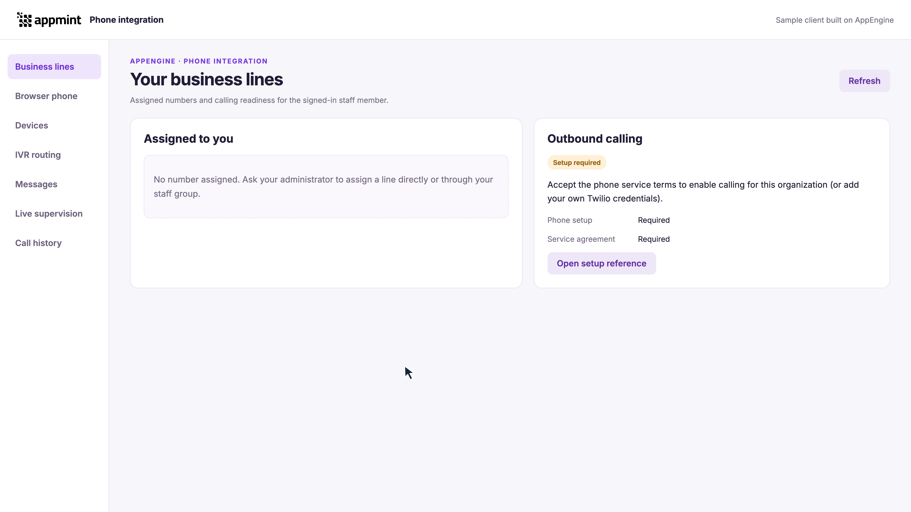

# AppEngine Phone APIs: embed calling and SMS in your web or mobile app

**Course ID:** `appengine-phone-apis`
**Scope:** Client integration. Written guide updated; video production in progress. The course uses a clearly labelled contract simulator for repeatable call and message exercises, alongside separately identified actual AppEngine readiness reads. Simulated calling does not establish carrier audio or handset delivery.

[Download the client and examples](../examples/README.md) · [Run and configure the companion](../examples/README.md)

## 1. Put a business phone inside your application

Your staff member should be able to choose an assigned business line, place or answer a call, mute it, use a keypad, finish the conversation and find its history without leaving your application. The same client can compose an SMS and show its changing status. AppEngine supplies the staff-scoped line information, voice token, device presence and communications APIs; your browser or native voice SDK handles the call connection and audio.

We will build those client interactions in that order. The sample exercises the same request adapter and call-event interface with labelled simulated responses, so you can repeat incoming calls, rejection, token expiry and message failures without dialing anybody. Keep the simulation indicator visible. When switching to a configured deployment, replace the simulated transport and Device with the real adapters; keep the application's state and interaction logic.

Provider provisioning, number purchase and IVR administration belong to the existing [Phone setup course](phone-setup.md). They are prerequisites for a live deployment, not the subject of this client course.

## 2. Know which connection owns each state

There are three connections to keep separate. Your application authenticates the staff member to AppEngine. AppEngine returns a short-lived voice token for that person's organization-scoped identity. The voice SDK uses that token to register and handle calls.

An AppEngine device record is presence, not proof that the SDK registered. SDK registration is readiness, not an answered call. An outgoing request is an attempt, not a completed conversation. Drive the interface from the appropriate event or readback rather than advancing all three states after a single successful response.

Your web client needs an assigned-line selector, registration state, call state and controls. It also needs an explicit unavailable/error state. Avoid a dial pad that appears operational when no line is assigned or the SDK cannot connect.

## 3. Obtain the client inputs

Start with [API Foundations: connection details](foundations.md#2-create-the-organization) and [staff sign-in](foundations.md#7-sign-in-as-the-owner). Finish any challenge or required password change. You need the AppEngine address, organization ID and that staff member's completed access session. A customer session is a different identity.

The companion's trusted host retains the AppEngine bearer and gives the browser only the returned ephemeral voice token. Follow [Custom API Gateway](gateway.md) for the production browser-to-host boundary. The local sample's single recording session is not a public multi-user authentication service.

For a live connection, obtain an already configured line and staff assignment from your administrator. The exact prerequisites are [phone service and number setup](phone-setup/01-phone-service-and-number-setup.md), [number assignments](phone-setup/02-number-defaults-assignments-and-direct-routing.md) and, for texting, [SMS eligibility](phone-setup/03-sms-registration-and-preflight.md). Your client checks these inputs; it should not buy a number or repair provider configuration automatically when a user presses Call.

Open the maintained [AppEngine API Reference](https://appengine.appmint.io/documentation/) beside the example. Search for the named operation when you need its current fields. Use the explicit simulator mode in the companion for the repeatable exercises. Keep genuine AppEngine reads and fixture responses visibly distinct; a simulated provider SID must not be presented as a live carrier result.

## 4. Load the assigned line and readiness

Read [GET /phone/user-phones](https://appengine.appmint.io/documentation/#GET%20%2Fphone%2Fuser-phones) with the staff session. Render each returned number's label, E.164 `phoneNumber` and direct/group assignment. Preserve its `id` separately: the record identifier is not the caller ID. An empty list means there is no returned assigned line; ask for assignment rather than substituting a number from organization inventory.

Then read [GET /phone/voice/app](https://appengine.appmint.io/documentation/#GET%20%2Fphone%2Fvoice%2Fapp). Current AppEngine uses this for **outbound** readiness, although some hosted summary prose still describes inbound behavior. An HTTP success containing `ready:false` is a setup-needed result. Display the returned message. `ready:true` alone does not establish microphone or SDK readiness.

This particular screenshot is actual AppEngine readback: the training organization has no assigned number and needs setup/agreement. The configured states in the repeatable simulator are separate labelled fixtures.

For SMS, verify the chosen number's [requirements](https://appengine.appmint.io/documentation/#GET%20%2Fphone%2Fnumbers%2F%3AphoneId%2Fsms-requirements) and [status](https://appengine.appmint.io/documentation/#GET%20%2Fphone%2Fnumbers%2Fsms-status%2F%3AphoneId). Voice capability does not imply SMS eligibility; the default voice line and default SMS sender can differ.

## 5. Register an installation and connect its voice SDK

Persist a random `deviceId` for the installation. Reuse it for registration, renewal, heartbeat and logout. Another installation gets another ID. Browser tabs sharing an installation ID need a single connection owner or coordination.

Call [POST /phone/voice/register-device](https://appengine.appmint.io/documentation/#POST%20%2Fphone%2Fvoice%2Fregister-device) with `platform:"web"`, that ID, a useful label and the supported capabilities. Use the returned `identity` verbatim. Do not rebuild it from an email. Keep the AppEngine bearer and the returned voice `token` separate.

If `voiceAvailable:false` or the token is absent, display the reason and stop before creating a Device. For an available registration, load the actual [Twilio browser Device SDK](https://www.twilio.com/docs/voice/sdks/javascript/twiliodevice), create the Device with the voice token, attach handlers and register it. The sample's simulated Device implements the client-facing event contract for exercises; it is not a Twilio network connection.

| Client state | What changes it |
|---|---|
| Platform registration available | AppEngine returns the voice token and identity |
| SDK connecting | Your Device registration starts |
| SDK registered | The Device emits `registered` |
| Incoming ringing | The Device emits `incoming` with a Call |
| Connected | The Call emits `accept`, or reports its actual open state |
| Ended or failed | The Call emits its terminal/error event |

Use HTTPS and microphone permission for a deployed browser phone. Keep Call disabled until the SDK is registered and `outboundReady` is true. A failed SDK registration must clean up its own AppEngine presence; it must not leave a convincing online badge.

## 6. Make an outgoing call and control it

Choose `from` from the returned assigned lines and collect the destination. The important AppEngine contract is `CallerIdOverride`: pass the selected phone number there when connecting the Device. The companion also supplies destination parameters `To` and `phone`; do not substitute Twilio's reserved `From` parameter.

Disable repeated submission while connecting. Show Calling until the actual Call event establishes connection. Attach handlers before relying on the display, and handle a Call already open when the connection promise resolves. A rejected or failed attempt should not leave active-call controls enabled.

Mute changes the Call's microphone state. Keypad digits during a call go to `sendDigits`; they are not appended to a future destination. Hang up disconnects the active Call, then the terminal event clears the controls. Keep the selected line and call identity so the user can inspect the matching history afterward.

In simulator mode, the controlled events demonstrate the UI transitions. On a real deployment, the same events come from the provider SDK. Do not infer two-way audio from a green Connected badge alone.

## 7. Answer, reject and finish an incoming call

On `incoming`, preserve that Call object and display its reported caller. Answer invokes the Call's accept action; Reject invokes its reject action. The final state still comes from the event lifecycle. If the caller cancels while the dialog is open, close the dialog and remove its stale actions.

Prevent a second incoming event from overwriting an active Call. Apply your intended busy behavior explicitly. A late event from a destroyed Device must not update the next signed-in user's screen; bind handlers to the current connection generation.

Exercise both answer and reject in the simulator, then the caller-cancel case. These are different terminal paths even when the client ends with no active call. The app controls one client endpoint; changing the organization's incoming number route is not part of this interaction.

## 8. Send SMS and show its changing status

Use [POST /crm/inbox/update](https://appengine.appmint.io/documentation/#POST%20%2Fcrm%2Finbox%2Fupdate) with `data.deliveryType:"sms"`, the eligible `from`, a recipient `to` array and `text`. For sending, `send:true` is a **query value**. In the official JavaScript request transport its fourth argument is `{send:true}`, not `{query:{send:true}}`. Saving without it is a draft operation.

Keep the returned message identity and result on screen before any refresh. Disable duplicate submission while the request is pending. If refreshing status fails after a successful send, preserve the known result and offer a read retry; do not resend merely to rebuild the conversation view.

Read the appropriate message history, using [GET /crm/communications/sms](https://appengine.appmint.io/documentation/#GET%20%2Fcrm%2Fcommunications%2Fsms) for stored communications or the maintained [provider-backed SMS history](https://appengine.appmint.io/documentation/#GET%20%2Fcrm%2Fcommunications%2Ftwilio-sms) when that is your application's chosen source. Match the actual record/provider identifiers and participants. Display the status returned by that source; do not manufacture Delivered from the send button resolving.

The simulator can produce queued, delivered, failed and incoming-reply fixtures to exercise these states. Label them simulated even when the UI uses the real message renderer. The fixtures establish how the client reacts, not an actual handset receipt.

## 9. Reconcile history and recover without repeating an action

Load [GET /crm/communications/calls](https://appengine.appmint.io/documentation/#GET%20%2Fcrm%2Fcommunications%2Fcalls) with the intended filters, then match the call SID and participants. Handle the response's paginated `data` rather than assuming the whole response is an array. A history fetch failure, an empty successful list and a loaded completed call are three separate UI states.

Recording, transcript and menu path are optional. Render only returned artifacts. If your application plays a permitted recording, use the authenticated AppEngine recording-audio route through the session-aware host; do not expose provider credentials or assume a raw provider URL is public. History describes the outcome; it should not trigger a new call.

| Failure | Client response |
|---|---|
| No assigned line or setup-needed | Explain the returned state and link the administrator's setup route |
| SDK registration failed | Show the SDK error, stop presence refresh and clean up this installation |
| Lost call/send response | Reconcile the known operation/history before considering another action |
| Status refresh failed | Retain the known call/message result and retry only the read |
| Old Device event arrives after logout | Ignore it; the old connection no longer owns the screen |

## 10. Renew, reconnect and sign out cleanly

Heartbeat and token renewal solve different problems. [POST /phone/voice/heartbeat](https://appengine.appmint.io/documentation/#POST%20%2Fphone%2Fvoice%2Fheartbeat) refreshes presence for the same device ID; current server presence expires after 90 seconds. Refresh about every 60 seconds while the SDK is registered. Stop the timer on SDK unregistration, terminal error or logout, and guard a callback that was already queued.

On `tokenWillExpire`, request a new registration with the same installation ID, check that the result contains an available token, then update the existing Device. Do not install null after a failed renewal. Expose the recovery state and disable actions that need a valid connection.

On logout, stop heartbeat, invalidate old callbacks, destroy/unregister the SDK and remove only this installation through [POST /phone/voice/unregister-device](https://appengine.appmint.io/documentation/#POST%20%2Fphone%2Fvoice%2Funregister-device). Coordinate an in-flight renewal so it cannot recreate presence after cleanup. Other device IDs remain separate. A page-unload promise is not guaranteed to complete, so expiry remains a fallback.

The companion includes offline regressions for unavailable registration, duplicate connection, stale callbacks, renewal during logout and preserving message results. These test client decisions, not a live provider connection.

## 11. Adapt the client to iOS and Android

The AppEngine operations and staff identity remain the same. A native installation uses `platform:"ios"` or `"android"`, its own stable ID and a native voice SDK. iOS sends `apnsEnvironment` matching the app's signing environment. A voice token can exist while background push is not ready.

The current Appmint native implementation provides concrete source entry points:

- `appmint_go/appmint_mobile/lib/services/softphone_service.dart`: AppEngine registration, identity, renewal, heartbeat, native token binding and organization switching.
- `appmint_go/appmint_mobile/lib/screens/phone/phone_screen.dart`: native call placement, call events, hang-up, mute and speaker controls.
- `appmint_go/appmint_mobile/lib/providers/communications_provider.dart`: assigned-line selection and communications data.

`SoftphoneService.registerDevice` binds the returned access token through `TwilioVoicePlatform.instance.setTokens`. Android obtains its device token through Firebase Messaging. iOS uses the plugin's PushKit registration; passing a Dart token or returning from `setTokens` does not alone prove an incoming push registration succeeded. When switching organizations, remove the previous native registration before binding the new organization's identity.

For your own app, follow the maintained [iOS voice setup](https://www.twilio.com/docs/voice/sdks/ios/get-started) or [Android voice setup](https://www.twilio.com/docs/voice/sdks/android/get-started) for SDK installation, app permissions and push integration. Match your app identity and push environment to the provider account that issues its voice token. Use the native OS incoming-call UI and events; do not represent a browser dialog as CallKit or Android call UI.

The Flutter CRM example in `appmint-examples` only inspects phones/tokens; it is not the native dialer reference above. The course's simulated native states illustrate the integration contract. They are not evidence of a physical handset ringing in the background. Before releasing your own native application, verify foreground, background, lock-screen answer, logout and organization switching on that app.

## 12. Run and adapt the companion

Download the linked package and follow its [README](../examples/README.md) for the current simulator and live-mode commands. Keep `examples/`, `client/` and `assets/` together. The browser example owns the screen and SDK events; JavaScript, TypeScript, Python, curl, JSON and Postman examples cover AppEngine requests. Server languages do not replace the browser or native microphone SDK.

Use the simulator to exercise the full client lifecycle predictably. Switch to real AppEngine and a real Device only with the intended staff session, assigned line and configured application. Carry the same state distinctions forward: platform availability, SDK readiness, active Call and reconciled history.

The current actual readiness capture is separately identified. Simulation mode and its evidence are being produced under the client-only scope; the completed video will retain visible simulation labels. No carrier call, external SMS receipt or physical native ringing is claimed by this manuscript.
