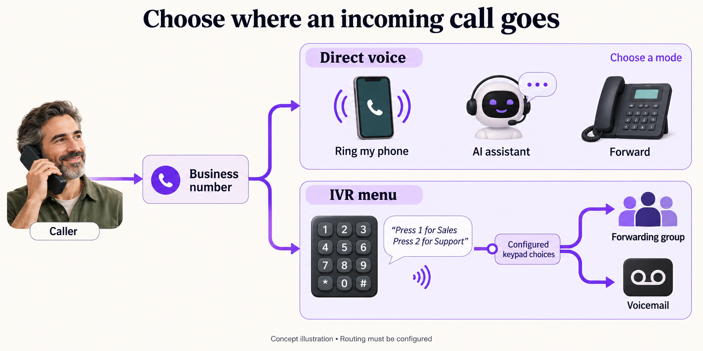
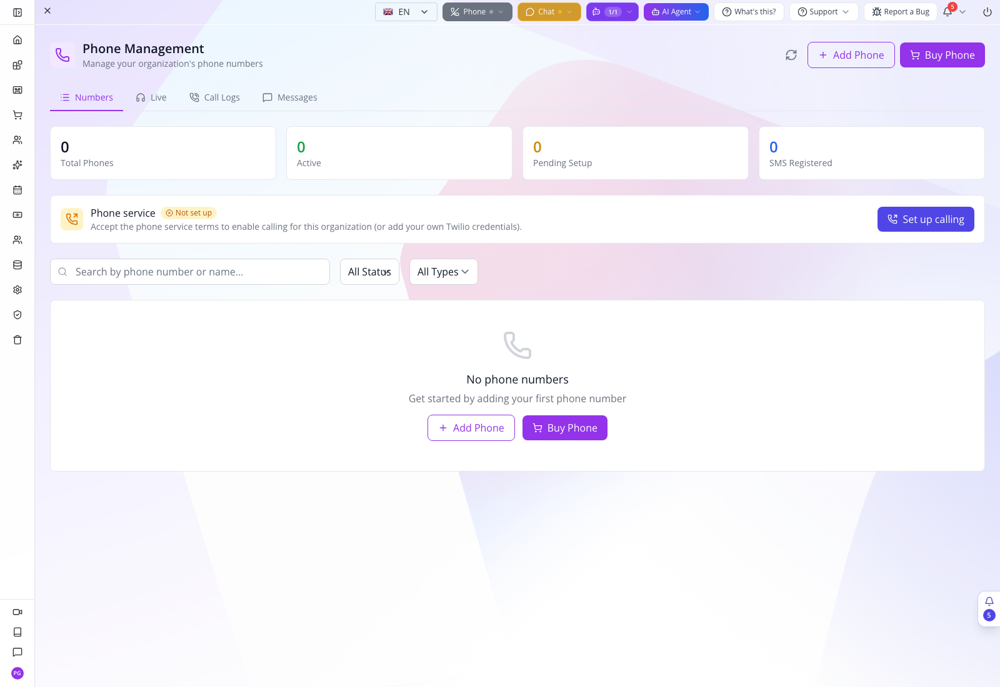
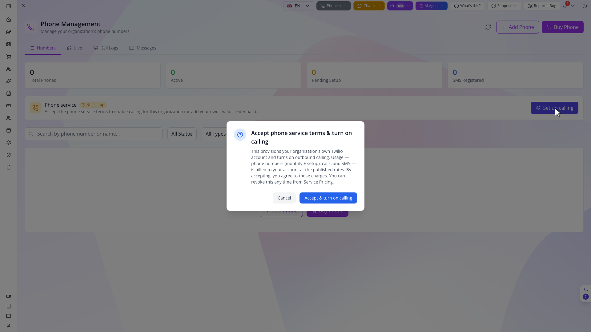
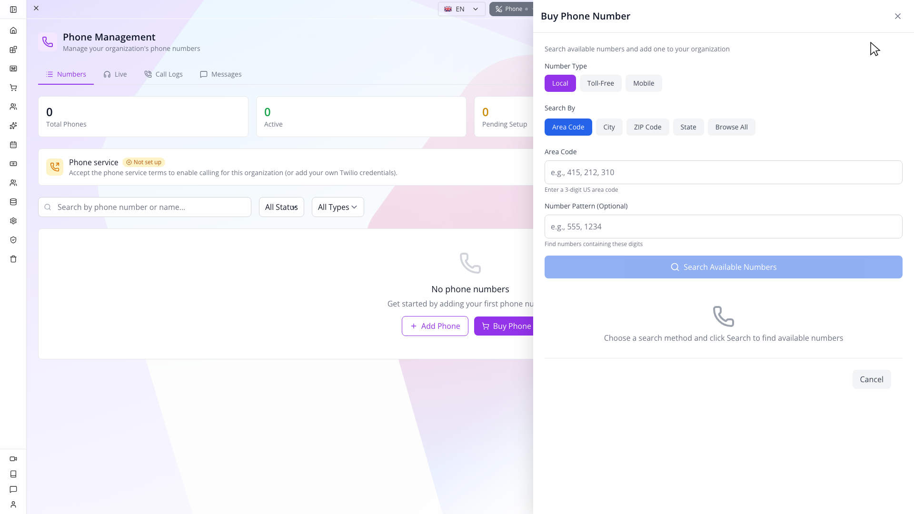
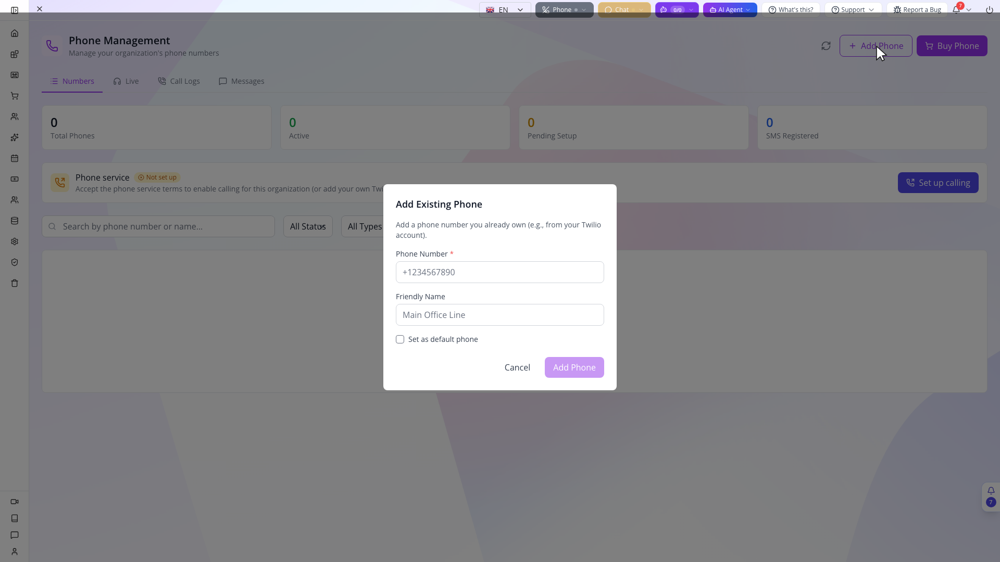

## Phone Service and Business Number Setup

Before choosing a route, separate the business number from the way it answers. Direct handling can ring a phone, forward the call or use an AI assistant. A keypad IVR instead asks the caller to choose a configured branch. These are alternative designs; the number does not run every branch at once. A no-answer fallback happens only when that fallback has been configured.

*Concept illustration, not an application screenshot. Choose a configured answering path; the arrows do not imply simultaneous ringing or an automatic AI fallback.*

Cedar & Form wants one business number that customers can call or text. During staffed hours, callers should reach the right person. When nobody answers, the business should retain the request. A customer who texts a known keyword should receive the appropriate response. We will build that operation from the number outward so that a saved menu is never mistaken for a working telephone service.

Use the organisation that will own the line, an administrator permitted to configure it, an actual receiving phone or staff device, and controlled participants for call and SMS tests. Have the business's real registration details ready if its SMS use requires registration. The example names and wording in this course are training drafts. Enter real owned numbers for operational tests; do not call a number copied from a placeholder or an older course screenshot.

Open **Configuration → Phone & SMS**. In Studio Manager, the full page path is `/app/phone-system`—for example, `https://studio.appmint.io/app/phone-system`. The app directory calls this module `/phone-system`; that is an internal app route, not a complete browser URL. Its current tabs are **Numbers**, **Live**, **Call Logs** and **Messages**. On Numbers, inspect **Phone service** or **Outbound calling**. **Not set up**, **Off** and **On** identify different conditions. If service is not configured, **Set up calling** opens the phone-service terms and provisioning flow. Review the displayed terms and complete that setup when the organisation intends to enable service. If setup exists but calling is off, use **Turn on calling**. Inspect the returned status and any error before moving on.

*Current training organization: the service has not been set up and no number is connected. This is the starting state, not a completed calling setup.*

Selecting **Set up calling** opens **Accept phone service terms & turn on calling**. Read the service scope before choosing **Accept & turn on calling**; choose **Cancel** if you are only inspecting the setup. The dialog concerns provider phone-number, call and SMS usage charges. **Appmint and Appmint Mobile are free applications**; these provider charges are separate from using the apps. Review the current displayed terms and rates instead of treating an example screenshot as a price quote.

*The actual confirmation was opened and cancelled. No terms were accepted, provider account provisioned or calling service enabled for this capture.*

**Rebuild** is a repair for an existing voice app, such as after a host or credential change. Do not use it as a general refresh for every failed call. The displayed On state establishes service readiness reported by the server; the later two-way call is the operation check.

Choose **Buy Phone** to search available numbers. Select **Number Type**: Local, Toll-Free or Mobile where available. Choose **Search By** using Area Code, City, ZIP code, State or Browse, enter the relevant search value and click Search. Inspect the candidate's actual number, location and capabilities. A number suitable for voice is not automatically suitable for every SMS operation.

*This is the current number-search form. No search, available-number result or purchase was performed in this capture.*

Select the intended result and review **Selected Phone Number** and the configuration summary. **Also make calls from this number** enables outbound calling during purchase when selected. Complete the purchase only for the number the business intends to acquire, then return to Numbers and inspect its record. The availability search is read-only; the purchase confirmation acquires a real service. Use the actual current purchase information rather than a price quoted from this manuscript.

For an already owned number, use the available add-existing-number flow and enter its complete international number and **Friendly Name**, such as “Cedar main line.” After adding, open **Configure** and inspect **Provider Registration**, including provider, provider SID, account SID, status and Verified. Adding a record is not the same as transferring a number between carriers or proving the provider has connected it. A manually added unverified record can appear in a picker without receiving calls.

*Add Phone opens this existing-number dialog. Check Set as default phone deliberately; the dialog was cancelled without adding a number. A saved number record still needs provider ownership and routing verification.*

In **Webhook Configuration**, inspect **Voice URL**, **SMS URL** and **Status Callback URL**. **Direct Voice** and **IVR Menu** select different incoming-call routes, and switching mode updates the provider's voice webhook. Keep Direct Voice while testing the simple staff line; switch to IVR Menu when you are ready to test the IVR configuration. Use the URLs generated for the current installation. An old documentation endpoint or a URL from a different organisation will not route this number correctly.

Before leaving, search the Numbers list by the friendly name and reopen the same record. Confirm that identity, capabilities and configuration are retained. If the list failed to load, retry it rather than interpreting missing figures as no numbers. **Release Number** is for deliberately giving up a line; it is not a troubleshooting reset or the ordinary way to end a training call.
